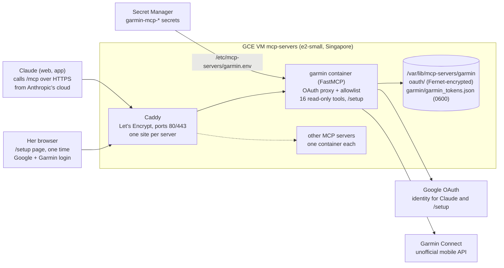
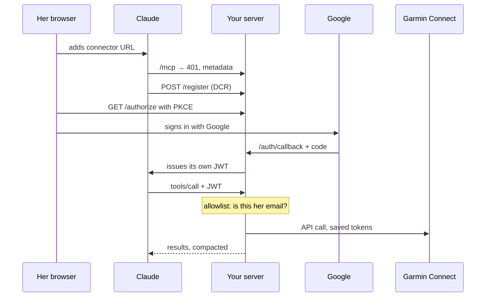

# Garmin MCP Connector — Technical Design

Updated 2026-10-19 for the shared `mcp-servers` layout. The user guide for the person
being connected is a separate doc: [Using Garmin with Claude](https://claude.ai/artifact/MydTugv1s4XXwhedWk4Ems).

## Overview

This is a single-user MCP server, hosted on a small GCE VM in your personal GCP project,
that lets one person's Claude web account read her Garmin Connect data through a custom
connector.

Garmin offers no official connector, and its Health API is partner-only. The hosted
third-party option means handing a Garmin password to an unknown operator. Self-hosting
keeps the session tokens on infrastructure you control and lets you read every line of
code that touches them.

**Goals**

- She adds one URL in Claude (Settings → Connectors) and can ask about sleep, HRV, Body
  Battery, training load and activities from claude.ai or the mobile app.
- Only her Google account can use the connector. Everyone else is refused at the MCP layer.
- She types her Garmin password and MFA code once, into a page on this server. Only
  session tokens are stored; the password is never written to disk or seen by you.
- You can build and test end to end with a throwaway Garmin account before handing over.

**Non-goals**

- Multi-user support. One allowlist, one Garmin token file.
- Write access. Every tool is read-only; scheduling workouts is left out on purpose.
- High availability. A single VM is fine for one person's occasional queries.

## Architecture

Caddy terminates TLS for every server in this repo; the garmin container does
authentication, tools and the setup page. Both run on one VM, which can host more MCP
servers, each in its own container on its own subdomain.



Claude never talks to Garmin directly. It calls `/mcp` on your server with a token your
server issued; the allowlist middleware checks the Google email behind that token before
any tool runs; only then does the app call Garmin with the stored session tokens.

| Component | What it does | Where it lives |
|---|---|---|
| Caddy | Gets and renews each server's Let's Encrypt certificate, proxies `GARMIN_DOMAIN` to `garmin:8000`, streams responses unbuffered | `deploy/Caddyfile` |
| OAuth proxy | FastMCP `GoogleProvider`. Speaks MCP's OAuth (dynamic client registration, PKCE) to Claude and plain Google OAuth upstream | `server.py` |
| Allowlist middleware | Rejects `tools/list` and `tools/call` unless the token's Google email is in `ALLOWED_EMAILS` | `server.py` |
| Tools | 15 typed read-only tools plus `query_garmin`, a guarded escape hatch for other `get_*` methods | `tools.py` |
| Garmin manager | Loads `garmin_tokens.json`, lets garminconnect refresh it, rebuilds the client once on an auth error | `garmin_client.py` |
| Setup page | Separate Google sign-in (Authlib), then the Garmin login form and MFA step | `setup_routes.py` |
| Persistent disk | OAuth client registrations and issued tokens (Fernet-encrypted), Garmin session tokens | `/var/lib/mcp-servers/garmin` on the VM |
| Secret Manager | Google client secret, signing and encryption keys, allowlist | 6 secrets named `garmin-mcp-*`, listed in `deploy/garmin.secrets` |

**Why a VM rather than Cloud Run.** The OAuth proxy must remember Claude's client
registration and the tokens it issued, and the Garmin tokens must survive restarts. On
Cloud Run that state would need Redis (Memorystore costs more than the VM). A VM with a
persistent disk keeps both in plain files, and the same VM can host the repo's other
servers.

## Authentication

There are two separate logins, and neither ever gives you her passwords: Google sign-in
proves who is calling, and a one-time Garmin login produces the session tokens the tools
use.

### Claude to your server (every session)

Claude's custom connectors use MCP's OAuth flow, which expects dynamic client
registration. Google doesn't support that, so FastMCP's `GoogleProvider` acts as an OAuth
proxy: it registers Claude itself, sends her to Google to sign in, then issues Claude its
own signed JWT.



In practice (checked 2026-10-19): Claude's connector dialog detects that the server supports
Claude's published client identity (CIMD) and uses it instead of `/register`; leave its
detected defaults. Before Google, FastMCP shows its own "Application Access Request" page
naming Claude and the verified `claude.ai` callback; she clicks Allow Access.

Google only proves identity. The allowlist middleware is what restricts access: with only
the OAuth proxy, anyone with a Google account who finds the URL could connect. The client
registration and issued tokens are persisted (Fernet-encrypted on disk, signed with
`JWT_SIGNING_KEY`), so a container restart doesn't force her to reconnect.

### Her browser to Garmin (once, then every few months)

1. She opens `/setup` and signs in with Google. This is a separate Authlib login because
   FastMCP's auth only guards `/mcp`. The same allowlist applies, and the session cookie
   lasts 1 hour.
2. She enters her Garmin email and password. The server starts garminconnect's login in a
   worker thread, with the password held only in that thread's memory.
3. If Garmin asks for MFA, the library calls a `prompt_mfa` callback. That callback blocks
   on a queue; the page shows the code form, and her submitted code is pushed onto the
   queue. The code waits up to 5 minutes.
4. On success, garminconnect writes `garmin_tokens.json` (mode 0600) into the token
   directory. The password object is discarded.
5. Tools load that file on first use. The library refreshes the access token on its own;
   a full re-login is needed only if the refresh token expires or Garmin revokes it.

Forms carry a CSRF token tied to the session, and the cookie is `HttpOnly`, `Secure`,
`SameSite=Lax`.

## Project structure and code

The app is about 700 lines of Python across five modules, pinned by `uv.lock` to the
versions that were tested (FastMCP 4.1.1, garminconnect 0.3.19). Deployment is shared
with the repo's other servers.

```
mcp-servers/
├── servers/garmin/
│   ├── src/garmin_mcp/
│   │   ├── config.py           # env vars → frozen Settings
│   │   ├── garmin_client.py    # GarminManager (tokens) + LoginSession (MFA worker)
│   │   ├── tools.py            # 16 read-only MCP tools
│   │   ├── setup_routes.py     # /setup page, Google sign-in, /healthz
│   │   └── server.py           # OAuth proxy, allowlist middleware, app, main()
│   ├── scripts/smoke_test.py   # OAuth sign-in + tool calls from your laptop
│   ├── Dockerfile              # python:3.12-slim, uv sync --frozen, non-root uid 10001
│   ├── pyproject.toml, uv.lock, .env.example
│   └── DESIGN.md               # this file
└── deploy/                     # shared by every server
    ├── .env.example            # account, project, region, VM name, one *_DOMAIN per server
    ├── lib.sh                  # laptop: pins gcloud to the personal account and project
    ├── provision-vm.sh         # laptop: VM service account, static IP, VM, firewall
    ├── garmin.secrets          # the 6 secrets this server needs and how each is made
    ├── create-secrets.sh       # laptop: secrets → Secret Manager, VM granted read access
    ├── deploy.sh               # laptop: copy the repo over IAP, run vm-bootstrap.sh
    ├── ssh.sh                  # laptop: shell or one command on the VM
    ├── vm-bootstrap.sh         # VM: Docker, data dirs, secrets, compose up
    ├── fetch-secrets.sh        # VM: Secret Manager → /etc/mcp-servers/<server>.env
    ├── docker-compose.yml      # caddy + one service per server
    └── Caddyfile               # one site per server
```

### Tools

| Tool | garminconnect call | Notes |
|---|---|---|
| `garmin_status` | `get_full_name` | Connected or not, plus the `/setup` link |
| `daily_summary` | `get_user_summary` | Steps, calories, intensity minutes, resting HR |
| `sleep` | `get_sleep_data` | Stages, score, overnight HRV and SpO2 |
| `heart_rate` | `get_heart_rates` | Intraday samples truncated |
| `hrv` | `get_hrv_data` | Overnight HRV and baseline |
| `stress` | `get_stress_data` | Average, max, time per band |
| `body_battery` | `get_body_battery` | Range capped at 31 days |
| `training_readiness` | `get_training_readiness` | Score and factors |
| `training_status` | `get_training_status` | Acute/chronic load |
| `fitness_metrics` | `get_max_metrics` | VO2 max, fitness age |
| `race_predictions` | `get_race_predictions` | 5K to marathon |
| `recent_activities` | `get_activities` | Up to 50, slimmed to 20 fields |
| `activities_between` | `get_activities_by_date` | Optional type filter |
| `activity_details` | `get_activity`, `get_activity_splits` | Summary plus laps |
| `body_composition` | `get_body_composition` | Weight, BMI, body fat |
| `query_garmin` | any `get_*` | Write-like prefixes refused |

All tools carry `readOnlyHint`, default dates to today in `TIMEZONE` (Asia/Singapore),
and pass results through `compact()`. That replaces any list longer than 48 items with its
count and first and last 3 items, since sleep and stress payloads hold per-minute series
that would otherwise fill Claude's context.

### Design choices worth knowing

- **Blocking library, async server.** garminconnect is synchronous, so every call runs via
  `anyio.to_thread.run_sync`. A lock guards client creation.
- **Self-healing client.** On an auth error the manager drops the client and retries once
  with tokens re-read from disk. A second failure becomes a tool error that tells Claude
  to send her to `/setup`.
- **MFA without a private API.** The login uses the library's documented `prompt_mfa`
  callback, bridged to the web form by a queue, rather than `return_on_mfa`, whose state
  object is undocumented.
- **Config split.** Secrets reach the container through `/etc/mcp-servers/garmin.env`;
  non-secret settings (`BASE_URL`, `TIMEZONE`) are set in `deploy/docker-compose.yml`, and
  `DATA_DIR=/data` in the Dockerfile.
- **Verified locally.** The app builds from `servers/garmin` with every route; `/mcp`
  returns 401 with the right OAuth challenge; all 16 tool methods exist with matching
  signatures in 0.3.19; the MFA state machine was tested with a stub for wrong and right
  codes. Real Google and Garmin logins still need the test pass below.

## Requirements

You need a personal GCP project with billing, a domain you control, and two Google
accounts: hers and a test one.

| Item | Detail | Who |
|---|---|---|
| Personal GCP project | Billing enabled, owned by your personal Google account, set as `PROJECT` in `deploy/.env`. Not a work project, so her health data stays off work infrastructure | You |
| gcloud logged into that account | `gcloud auth login <personal account> --no-activate` adds it without changing your default (work) config. The scripts stop if it's missing | You |
| Domain or subdomain | `GARMIN_DOMAIN` in `deploy/.env`, with an A record pointing at the VM's static IP. Needed for Let's Encrypt and the Google OAuth redirect URIs | You |
| Google OAuth client | Web application type, created in the personal project. Redirect URIs: `https://<domain>/auth/callback` and `https://<domain>/setup/callback`. Consent screen External, scopes `openid` and `email` only. Branding needs home page `https://<domain>/setup`, privacy policy `https://<domain>/privacy` and the registered domain (e.g. `example.com` for `garmin.example.com`) as an authorized domain before it can be published | You |
| Garmin test account | Free at connect.garmin.com, no device needed. Turn on MFA to test that path | You |
| Test Google account | Add it to `ALLOWED_EMAILS` during testing, remove before handover | You |
| Her Google account | The one she uses for Claude. Goes in `ALLOWED_EMAILS` | Her |
| Her Claude account | Any plan that allows custom connectors | Her |
| Laptop tools | `gcloud`, `openssl`, `uv` (for the smoke test) | You |

GCP services used: Compute Engine, Secret Manager, IAP (for SSH only). Nothing else is
enabled.

**Publish the OAuth consent screen.** In Testing status Google expires refresh tokens
after 7 days, which would make her reconnect weekly. With only `openid` and `email`
scopes, moving to In production needs no Google verification review.

## Deployment

Five steps, all run from your laptop at the repo root; budget about an hour the first
time, mostly waiting on DNS. Every laptop script runs gcloud as `GCLOUD_ACCOUNT` against
`PROJECT` from `deploy/.env`, whatever your default gcloud config says.

1. **Configure.** `cp deploy/.env.example deploy/.env` and set `GCLOUD_ACCOUNT`,
   `PROJECT` and `GARMIN_DOMAIN`.
2. **Provision the VM.** `bash deploy/provision-vm.sh` creates the `mcp-servers-vm`
   service account (no key file), the `mcp-servers-ip` static IP, an e2-small Debian 12
   VM with Shielded VM on, and firewall rules: 80/443 from anywhere, 22 from Google's IAP
   range only, and a deny rule for 22 from everywhere else that outranks the default
   network's allow-SSH rule. Point the domain's A record at the printed IP.
3. **Create the Google OAuth client.** In the personal project's console (check the
   account switcher): APIs & Services → OAuth consent screen: External, app name "Garmin
   for Claude", scopes `openid` and `email`, then publish. Credentials → Create OAuth
   client ID → Web application, with both redirect URIs from Requirements.
4. **Create secrets.** `bash deploy/create-secrets.sh garmin` prompts for the client ID,
   client secret and allowed emails, generates the JWT signing key, session secret and
   Fernet key, stores all six as `garmin-mcp-*` secrets, and lets the VM's service account
   read each one. Re-running it keeps existing secrets.
5. **Deploy.** `bash deploy/deploy.sh` copies the repo to the VM over IAP (without venvs or
   local `.env` files) and runs `vm-bootstrap.sh` there. That installs Docker and
   unattended security upgrades, creates `/var/lib/mcp-servers/garmin` owned by uid 10001,
   writes `/etc/mcp-servers/garmin.env` (mode 600) from Secret Manager, and runs
   `docker compose up -d --build`. Caddy fetches the certificate on first request.

Check it with `curl https://<domain>/healthz`, which should return `ok`.

**Updates** are `bash deploy/deploy.sh` again; it replaces only the code in
`~/mcp-servers` on the VM. **Rotating a secret** means
`bash deploy/create-secrets.sh garmin <ENV_VAR>` (for example `ALLOWED_EMAILS`), then
`bash deploy/deploy.sh`. Rotating `JWT_SIGNING_KEY` or `STORAGE_ENCRYPTION_KEY`
invalidates her Claude connection, so she reconnects once.

## Security model

The most sensitive thing on the server is her Garmin session token, which grants read and
write access to her whole Garmin account; everything below is about keeping that file
reachable only by the app and only on her behalf.

| Threat | Control in this build |
|---|---|
| Someone finds the URL and connects | Google sign-in plus `ALLOWED_EMAILS` on both `/mcp` and `/setup`; unverified Google emails refused |
| Her Garmin password leaks | Never stored or logged; held in one worker thread's memory during login; you never see it |
| Token file stolen from the VM | Mode 0600, owned by a non-root container user, on a Google-encrypted disk; SSH only through IAP with your Google identity, enforced by a deny rule over the default network's open SSH rule |
| OAuth state stolen from disk | Fernet-encrypted with a key that lives in Secret Manager, not on the image |
| Secrets in source control | None in the repo or image; pulled at deploy into a root-only env file. `deploy/.env` holds only non-secret settings and is gitignored |
| Deploying into the work GCP account by mistake | Laptop scripts set `CLOUDSDK_CORE_ACCOUNT` and `CLOUDSDK_CORE_PROJECT` from `deploy/.env` and never change the default gcloud config |
| Claude, or a prompt injection, writes to her account | Tools are read-only; `query_garmin` accepts only `get_*` methods |
| Cross-site form posts to `/setup` | CSRF token per session, `SameSite=Lax`, `Secure`, `HttpOnly` cookie |
| Unpatched OS or libraries | Unattended OS upgrades; you update the lockfile deliberately |

### Recommendations

- **Tell her plainly what you can technically access.** As the VM owner you can read the
  token file and therefore her Garmin data, even though you never see her password. Agree
  on that before handover.
- **Keep the project personal and small.** Only you as Owner; no other people in IAM. Turn
  on 2-step verification for the Google account that owns the project.
- **Don't log tool results.** The default logs record only request lines and refusals.
  Keep it that way: health data in Cloud Logging is a second copy to protect.
- **Remove your test account from `ALLOWED_EMAILS`** before she connects, and delete your
  test Garmin token with Disconnect on `/setup`.
- **Give her an exit.** Disconnect on `/setup` deletes the token file. Changing her Garmin
  password should also end the session at Garmin's end; confirm this with your test account.
- **Update deliberately.** Garmin changes its private API without notice. Bump
  garminconnect when it breaks, re-run the smoke test, then deploy; don't let it float.
- **Vet servers before they share the VM.** Containers can reach the VM's metadata server,
  whose service-account token reads every server's secrets, including `garmin-mcp-*`. Add
  only servers you trust as much as this one, or block `169.254.169.254` from containers
  first.

## Testing before handover

Run the whole path with your test Google and Garmin accounts on the real deployment; she
should be the second person ever to use it, not the first.

- [ ] `curl https://<domain>/healthz` returns `ok` and the certificate is valid
- [ ] `/setup` with a Google account not on the list shows "This Google account isn't allowed"
- [ ] `/setup` with your test account shows the Garmin form
- [ ] Wrong Garmin password shows the retry message, not a stack trace
- [ ] With MFA on, the code page appears, a wrong code fails cleanly, a right code shows "Garmin is connected"
- [ ] From `servers/garmin`, `uv run python scripts/smoke_test.py https://<domain>` lists 16 tools and returns `connected: true`
- [ ] In your own Claude account, add `https://<domain>/mcp` as a custom connector, sign in, ask "what were my steps today?"
- [ ] Same connector from a Claude account whose email is not on the list: tool calls are refused
- [ ] `bash deploy/ssh.sh 'cd mcp-servers/deploy && sudo docker compose restart garmin'`, then ask again: no reconnect needed
- [ ] Disconnect on `/setup`: tools now return the "connect Garmin at /setup" message
- [ ] `bash deploy/create-secrets.sh garmin ALLOWED_EMAILS` without your test email, then `bash deploy/deploy.sh`

An empty test account returns mostly empty payloads, which is expected. What you are
testing is the plumbing: auth, refusal, MFA, persistence and error messages.

## Operations

Once running, the server needs attention only when Garmin's session or API changes;
expect a re-login every few months and a library bump a few times a year.

| Event | What she sees | What you do |
|---|---|---|
| Garmin refresh token expires or is revoked | Claude says Garmin isn't connected and gives the `/setup` link | Nothing; she logs in again on `/setup` |
| Garmin changes its private API | A tool returns an error or empty data | Bump garminconnect, `uv lock`, smoke test, `deploy.sh` |
| Garmin rate-limits logins | "Garmin is limiting login attempts" on `/setup` | Wait about 30 minutes; avoid repeated retries |
| Claude connection lost after a key rotation | Claude asks her to reconnect the connector | Expected; one click in Claude |
| VM restarts or redeploys | Nothing | Nothing; state is on the persistent disk |
| Certificate renewal | Nothing | Nothing; Caddy renews automatically |

**Monitoring.** A free Cloud Monitoring uptime check on `https://<domain>/healthz` with
email alerts is enough. Logs:
`bash deploy/ssh.sh 'cd mcp-servers/deploy && sudo docker compose logs -f garmin'`. Watch
for `Refused MCP request` lines, which mean someone outside the allowlist tried to connect.

**Backups.** Not needed. Losing the disk means she reconnects in Claude and logs into
Garmin once more; nothing else is stored.

**Cost.** Roughly US$15–20 a month in asia-southeast1: the e2-small VM is most of it, plus
the in-use static IP and a 20 GB disk, shared by every server on the VM. An e2-micro (1 GB
RAM) roughly halves that and is likely enough for one user; check the GCP pricing
calculator for current numbers.

## Known limitations and risks

The biggest risk is outside your control: this depends on Garmin's private mobile API,
which Garmin can change or block at any time.

- **Unofficial API.** garminconnect impersonates the Garmin mobile app. The older
  garth-based login stopped working in March 2026 and garminconnect 0.3 replaced it;
  expect similar breaks.
- **Datacenter IP at login.** Garmin's login may challenge or block requests from cloud
  IPs. garminconnect tries several strategies, including curl_cffi browser impersonation.
  If her login fails from the VM, generate `garmin_tokens.json` on a home machine and copy
  it into `/var/lib/mcp-servers/garmin/garmin/` (owner uid 10001, mode 0600). On the
  first real login from the VM (2026-10-19), garminconnect's two mobile strategies got
  HTTP 429 from Garmin and a fallback strategy succeeded, so this is already marginal.
- **Terms of service.** Automated access through the private API is a grey area under
  Garmin's terms. The risk to her account is low for personal read-only use, but not zero.
- **Single user.** One allowlist, one token file. A second person would need a second
  deployment or a redesign keyed by email.
- **Shared VM.** Every server on the VM shares one service account and one kernel; see
  "Vet servers before they share the VM" above.
- **You hold the keys.** Self-hosting moves trust from an unknown third party to you, not
  to nobody.
- **FastMCP major versions.** This targets FastMCP 4.1. Its auth APIs changed across 2.x,
  3.x and 4.x, so read release notes before bumping across a major version.

## Handover checklist

- [ ] Every item in Testing before handover is ticked
- [ ] Her Google email is in `garmin-mcp-allowed-emails`; your test email is gone
- [ ] Test Garmin token deleted with Disconnect
- [ ] OAuth consent screen is published (In production)
- [ ] Uptime check on `/healthz` is alerting your email
- [ ] She has the [user guide](https://claude.ai/artifact/MydTugv1s4XXwhedWk4Ems), with its setup and connector links filled in
- [ ] You've told her what you can access as the server owner and how to disconnect
